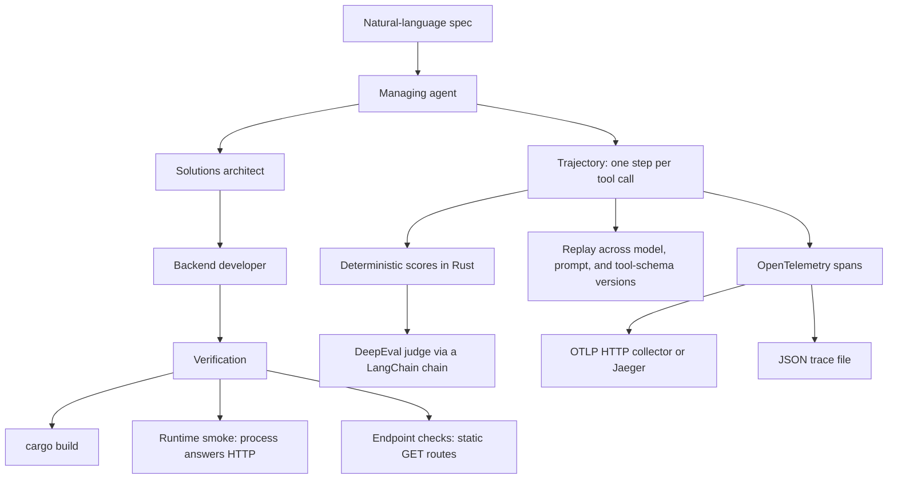

# actix_autogpt

A multi-agent system in Rust that turns a natural-language spec into an Actix-web service. A project manager turns the request into a goal, a solutions architect decides the scope and checks external URLs, and a backend developer writes the server, then the same verification path builds it, starts it, and calls its routes.

The original agent loop is intact. This repo adds the pieces that make a run measurable: automated verification, an evaluation report, OpenTelemetry traces, and a trajectory replay harness.



## Layout

| Path | What it is |
| --- | --- |
| `src/models/agents_manager` | Managing agent. Turns the request into a goal and runs the other agents. |
| `src/models/agents/agent_architect.rs` | Scope and external URL checks. |
| `src/models/agents/agent_backend.rs` | Writes Actix-oriented server code and drives verification, including the compile-fix loop. |
| `src/ai_functions` | Prompt contracts. `#[ai_function]` freezes each function, docs included, into the string sent to the model. |
| `web_template` | Actix-web project the interactive agent reads and overwrites. |
| `src/verification.rs` | Build check, runtime smoke test, and endpoint checks. |
| `src/telemetry.rs` | OpenTelemetry export. |
| `src/replay.rs`, `src/trajectory.rs`, `benchmarks/` | Recorded runs, the 8-spec benchmark, and the regression report. |
| `src/scoring.rs` | Deterministic spec, tool-selection, and error-recovery scores. |
| `eval/` | DeepEval metrics. LangChain builds the judge prompt. |

## Quickstart

Requirements: Rust stable (edition 2024, so 1.85 or newer) and a network connection the first time Cargo fetches crates.

```bash
cargo test
cargo run -- verify --project web_template --route /health
```

The second command compiles the Actix template, starts it on a free port, and checks `GET /health`.

Interactive generation calls OpenAI. Copy `.env.example` to `.env` and set a key. `OPEN_AI_KEY` and `OPENAI_API_KEY` are both accepted. `OPEN_AI_ORG` is optional.

```bash
cargo run
```

`AUTO_CONFIRM=1` skips the prompt that asks you to approve running generated code. Without a key, use replay and the judge instead of `cargo run`.

## Environment

| Variable | Default | Role |
| --- | --- | --- |
| `OPEN_AI_KEY` or `OPENAI_API_KEY` | unset | Live model calls. Replay and CI do not need it. |
| `OPEN_AI_ORG` | unset | Optional OpenAI organization header. |
| `OPENAI_MODEL` | `gpt-4` | Model name sent to the API and recorded on the trajectory. |
| `PROMPT_VERSION` | `v1` | `v1` is the original function-printer instruction. `v2` is a stricter one. |
| `TOOL_SCHEMA_VERSION` | `v1` | `v2` appends the route-schema rules to the prompt. |
| `WEB_SERVER_PROJECT_PATH` | `web_template` | Actix project the backend agent edits. |
| `AUTO_CONFIRM` | off | Skip the manual code-approval prompt. |
| `SKIP_NETWORK_CHECKS` | off | Treat external URL checks as HTTP 200. |
| `SMOKE_TIMEOUT_SECS` | `15` | How long to wait for `GET /health`. |
| `OTEL_TRACES_FILE` | unset | Write spans to this JSON file on shutdown. |
| `OTEL_EXPORTER_OTLP_ENDPOINT` | unset | Also export OTLP/HTTP, for example `http://localhost:4318`. |
| `RUST_LOG` | `info` | Span filter. `info` keeps the agent and tool spans. |
| `EVAL_LIVE` | off | Python judge calls ChatOpenAI instead of the offline rubric. |

## Verification

`src/verification.rs` is what the backend agent calls after it writes `src/main.rs`.

1. **Build check.** `cargo build` in the project. Compiler output is kept for the fix loop and for failure signatures such as `E0308`.
2. **Runtime smoke test.** The built binary is spawned with `PORT` set. Smoke passes when `GET /health` returns any HTTP response before the timeout.
3. **Endpoint checks.** Static `get` routes from the extracted schema are called. A route passes when the status is 200.

The generated server is expected to read `PORT` (default `8080`) and serve `GET /health`. The Actix template does both. Up to three failed builds go back through `print_fixed_code`; a later successful build is recorded as a recovered error.

```bash
cargo run -- verify --project web_template --route /health
```

## Evaluation

Two layers score the same three axes: spec compliance, tool selection, and error recovery.

The Rust layer is deterministic and does not call a model. Spec compliance checks the goal text, the three scope flags, and whether expected routes showed up in the schema. Tool selection is recall of the expected tool list, with a penalty when the architect takes an external-URL branch the spec did not ask for. Error recovery is 1 when a failed `cargo build` is followed by a successful one, or when the build never failed, and 0 when every build failed.

The Python layer is a DeepEval metric per axis. LangChain's `ChatPromptTemplate` builds the judge prompt, and the chain is either:

* an offline rubric model, used in CI and in the checked-in sample, or
* `ChatOpenAI` when `EVAL_LIVE=1` and an API key is set.

```bash
python -m pip install -r eval/requirements.txt
python -m eval.run_eval \
  --trajectories docs/sample_trajectories.json \
  --out docs/sample_eval_report.md \
  --json docs/sample_eval_report.json
```

Live judging is the same command with `--live`. GitHub Actions runs the offline tests on every push and runs the live judge only when `OPENAI_API_KEY` or `OPEN_AI_KEY` is configured as a repository secret. `cargo test` ignores the OpenAI integration tests; run those with `cargo test -- --ignored` after exporting a key.

From a sample of the offline report:

| Spec | Version | Outcome | Spec det / judge | Tools det / judge | Recovery det / judge |
| --- | --- | --- | --- | --- | --- |
| todo-api | gpt-4 / v1 / v1 | success | 1.00 / 1.00 | 1.00 / 1.00 | 1.00 / 1.00 |
| todo-api | gpt-4o / v1 / v1 | failure | 0.83 / 0.83 | 0.50 / 0.50 | 1.00 / 1.00 |
| weather-api | gpt-4 / v1 / v2 | failure | 1.00 / 1.00 | 0.63 / 0.63 | 0.00 / 0.00 |
| bookmarks-api | gpt-4 / v1 / v1 | success | 1.00 / 1.00 | 1.00 / 1.00 | 1.00 / 1.00 |

The full table, including the judge's sentences, is `docs/sample_eval_report.md`.

## Replay

Replay re-runs the eight benchmark specs through the real manager, architect, and backend, four versions each: model `gpt-4` and `gpt-4o`, prompt `v1` and `v2`, tool schema `v1` and `v2`. A fixture model answers from `benchmarks/fixtures`. The baseline is `gpt-4 / prompt v1 / schema v1`. Other cells are diffed against it, and failures that share a mode and a signature are clustered.

```bash
cargo run -- replay \
  --out docs/sample_replay_report.md \
  --trajectories docs/sample_trajectories.json
```

The checked-in run is 32 trajectories, 10 failures, 5 clusters. The clusters are compiler error `E0308` after the fix loop gave up, `GET /weather` returning 500, a login flag drifting off the spec, an external-URL branch the spec did not ask for, and route schemas that used `GET` instead of `get` so the endpoint probe skipped them. `bookmarks-api` on the baseline fails its first build and recovers. See `docs/sample_replay_report.md`.

Benchmark servers under `benchmarks/code` are tiny standard-library HTTP binaries so the suite does not download crates. The interactive agent and `verify --project web_template` still build the Actix template. Both paths call `verification::build_project` and `verification::probe`.

## Traces

Each run opens an `agent.run` span. Each specialist is an `agent.step`, each state in the loop is an `agent.state`, and each model call, build, smoke check, and endpoint check is a `tool.call`.

Write them to a file with no collector:

```bash
cargo run -- trace-demo --out docs/sample_trace.json
```

`docs/sample_trace.json` is that file for the todo-api benchmark. A tool span looks like this, with the file and line attributes shortened:

```json
{
  "name": "tool.call",
  "trace_id": "…",
  "span_id": "…",
  "parent_span_id": "…",
  "attributes": [
    {"key": "agent", "value": "String(Owned(\"Backend Developer\"))"},
    {"key": "tool", "value": "String(Owned(\"cargo_build\"))"}
  ],
  "status": "Unset"
}
```

The same process exports OTLP/HTTP when `OTEL_EXPORTER_OTLP_ENDPOINT` is set. Jaeger all-in-one listens on port 4318:

```bash
docker compose -f deploy/jaeger-compose.yaml up
OTEL_EXPORTER_OTLP_ENDPOINT=http://localhost:4318 cargo run -- trace-demo --out /tmp/trace.json
```

The UI is at `http://localhost:16686`. Search for the service name `actix_autogpt`.

## Design decisions

The agent control flow is still the state machine from the original project: discovery, working, unit testing, finished. New behavior hangs off that loop instead of replacing it.

* **One verifier.** The backend agent's build-and-probe block now calls `verification`. Replay and `verify` call those same functions, so a benchmark failure and an interactive failure are the same kind of evidence.
* **Task-local run config.** Model, prompt version, tool schema, the fixture client, and the trajectory recorder sit in Tokio task-locals. Agent method signatures stay the ones the manager already calls.
* **Prompt versions are real prompt text.** `v1` is the original "function printer" instruction. `v2` replaces that wording. Tool schema `v2` appends the route-schema rules. The model name is the third axis and selects both the API body and the fixture directory.
* **Tool selection is the branch the model causes.** The state machine picks the function. The model decides the branch: external URLs or not, and whether a broken build is repaired. The score compares that trace with the tools the spec required.
* **The judge is Python because DeepEval and LangChain are Python.** Rust owns the trajectory JSON. The offline judge applies the published rubric so CI does not need a key. `EVAL_LIVE=1` swaps in ChatOpenAI without changing the metric.
* **Replay fixtures are hermetic.** They return complete `main.rs` files and a route schema. That makes the 32-run matrix deterministic. The Actix template remains the interactive target and is what CI's verify step builds and probes.
* **Traces are optional.** With no endpoint and no `OTEL_TRACES_FILE`, the process only installs a formatting subscriber. Setting either variable adds an exporter. The file exporter needs no collector.

## Tests and CI

```bash
cargo fmt --all -- --check
cargo clippy --all-targets -- -D warnings
cargo test
python -m unittest eval.test_eval
```

`.github/workflows/ci.yml` runs the Rust checks, verifies the Actix template, and runs the offline judge. Live model tests are `#[ignore]`d. The live judge step exits 0 when the OpenAI secret is absent.

## Background

The agent structure follows the Udemy course *Learn Rust Whilst Taking ChatGPT to the Extreme In Creating an Automated GPT that Builds and Tests Code for You*. Paths are environment variables now, with `web_template` as the default, instead of a machine-specific directory.
